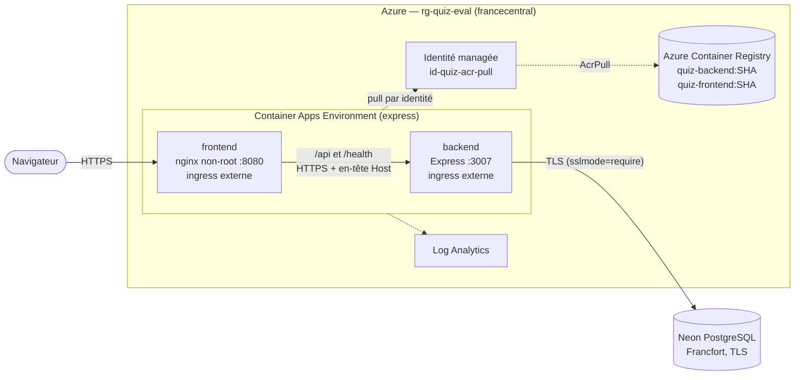
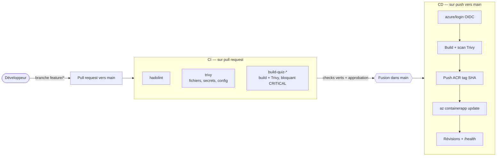

# Quiz App — conteneurisation, sécurité et déploiement Azure

Application de quiz (frontend Vite, backend Express, PostgreSQL) conteneurisée,
analysée avec Trivy, publiée dans Azure Container Registry puis déployée sur
Azure Container Apps par une chaîne CI/CD GitHub Actions. La logique métier est
celle fournie ; ce dépôt porte la conteneurisation, la sécurité, le déploiement
et l'automatisation.

## Liens

| Quoi | URL |
|---|---|
| Application (frontend) | https://frontend.icywater-e65437c8.francecentral.azurecontainerapps.io |
| Page d'administration | https://frontend.icywater-e65437c8.francecentral.azurecontainerapps.io/gestion-quiz |
| Contrôle de santé | https://frontend.icywater-e65437c8.francecentral.azurecontainerapps.io/health |
| Dépôt | https://github.com/adam-benyekkou/eval-quiz-app |
| Pull requests | https://github.com/adam-benyekkou/eval-quiz-app/pulls?q=is%3Apr |
| Exécutions CI/CD | https://github.com/adam-benyekkou/eval-quiz-app/actions |
| En local (Compose) | http://localhost:8087 |

`/health` répond `{"status":"ok"}` sans requête SQL : il prouve que le backend
tourne, pas que la base répond. L'URL Azure disparaît si le resource group est
détruit (`scripts/destroy.sh`).

## Architecture



Dans un environnement Container Apps *express*, il n'y a ni DNS interne ni HTTP
clair : le frontend joint le backend par son FQDN public en HTTPS. Le backend
n'est donc pas privé ; il est protégé par son authentification applicative et
la restriction d'IP n'est pas applicable (IP sortantes non exposées). Détails et
écarts dans [`docs/deploiement-azure.md`](docs/deploiement-azure.md).

En local, Docker Compose lance `db` (PostgreSQL 16, volume `pgdata`), `backend`
et `frontend`. Seul le port 8087 du frontend est publié ; la base et le backend
ne le sont pas.

## Chaîne CI/CD



### Les briques

| Brique | Fichier | Déclencheur | Rôle |
|---|---|---|---|
| **Hadolint** | `.github/workflows/hadolint.yml` | PR vers `main` | Lint de tous les Dockerfile : mauvaises pratiques (tags non fixés, utilisateur root, couches inutiles). |
| **Trivy — système de fichiers** | `.github/workflows/trivy.yml` | PR vers `main` | Scan du dépôt : vulnérabilités des dépendances, secrets committés, mauvaises configurations (Dockerfile). Bloquant CRITICAL ; rapport SARIF dans l'onglet Security. |
| **Build des images** | `.github/workflows/ci.yml` (`build-quiz-backend`, `build-quiz-frontend`) | PR vers `main` | Construit les deux images avec Buildx et cache GHA, sans publier. Prouve que les Dockerfile compilent. |
| **Trivy — images** | `.github/actions/build-scan` (via `ci.yml`, `build-quiz-*`) | PR vers `main` | Scanne les images construites. Étape bloquante : une vulnérabilité **CRITICAL** fait échouer le job (`exit-code: 1`, pas de `continue-on-error`). |
| **Protection de `main`** | réglage GitHub | — | Pull request obligatoire avec approbation, checks requis, force-push et suppression interdits. Une CI rouge empêche la fusion. |
| **Hook co-auteurs** | `.githooks/prepare-commit-msg` | commit local | Ajoute les trailers `Co-authored-by` à chaque commit. |
| **CD Azure** | `.github/workflows/cd.yml` | `push` vers `main` uniquement | Rebuild, scan Trivy CRITICAL avant tout push, publication dans l'ACR avec le SHA du commit, mise à jour du backend puis du frontend (nouvelle révision), contrôle des révisions et de `/health`. |
| **OIDC Azure** | `scripts/setup-oidc.sh` | une fois | Identité managée avec identifiant fédéré limité à `main` de ce dépôt ; rôles minimaux `AcrPush` + `Contributor` sur le resource group. Aucun mot de passe stocké. |

Pourquoi trois scans : le lint (Hadolint) juge la *recette*, Trivy fichiers juge
le *dépôt*, Trivy images juge le *résultat construit*, y compris l'image de base
et les paquets système. Aucun ne remplace les autres.

Le déploiement ne tourne jamais sur `pull_request` : aucune contribution non
approuvée n'atteint les identifiants Azure. Voir [`docs/cicd.md`](docs/cicd.md).

## Démarrer en local

```bash
cp .env.example .env            # valeurs fictives ; le vrai .env n'est jamais commité
docker compose up -d --build
curl -i http://localhost:8087/health
```

Persistance : `docker compose down` conserve les données (volume `pgdata`),
`down -v` les supprime. `database/init.sql` n'est joué qu'au premier démarrage
d'un volume vide.

## Déployer sur Azure

```bash
az login
./scripts/deploy.sh                 # RG, ACR, images, Container Apps (idempotent)
./scripts/setup-oidc.sh             # une fois : OIDC pour la CD
export DATABASE_URL='postgres://…?sslmode=require'   # base Neon, secret : jamais commité
./scripts/init-db.sh                # schéma, une seule fois
./scripts/deploy.sh --skip-build    # branche DATABASE_URL en secret de l'app
./scripts/destroy.sh                # nettoyage (confirmation par saisie du nom du groupe)
```

Après la première mise en place, `cd.yml` prend le relais à chaque fusion dans
`main`.

## Structure du dépôt

| Chemin | Contenu |
|---|---|
| `main.js`, `backend/server.js`, `questions_*.js` | Code applicatif fourni (logique métier non modifiée) |
| `Dockerfile`, `backend/Dockerfile`, `nginx/` | Images durcies (non-root, multi-étapes, nginx paramétré) |
| `docker-compose.yml`, `.env.example` | Pile locale |
| `scripts/` | `deploy.sh`, `destroy.sh`, `init-db.sh`, `setup-oidc.sh`, `lib.sh` |
| `.github/workflows/` | `hadolint.yml`, `trivy.yml`, `ci.yml`, `cd.yml` |
| `database/` | Schéma SQL et procédure Neon |
| `docs/` | Consignes du cours et documentation du projet |
| `plan/` | Plan de réalisation (une étape = un fichier) |
| `preuves/` | Sorties de commandes expurgées par jalon (J0 à J6) |

## Documentation

Projet :

- [Architecture locale](docs/architecture-locale.md)
- [Sécurité des images (Trivy)](docs/securite-trivy.md) et [rapport d'améliorations J2](docs/rapport-ameliorations-j2.md)
- [Déploiement Azure](docs/deploiement-azure.md)
- [CI/CD](docs/cicd.md)
- [Base de données](database/README.md)
- [Plan de réalisation](plan/README.md)

Consignes du cours :

- [Présentation](docs/01-presentation-projet.md) · [Consignes techniques](docs/02-consignes-techniques.md) · [Jalons](docs/03-jalons-validation.md) · [Exigences CI/CD](docs/04-pipeline-cicd.md)
- [Fonctionnalités avancées](docs/05-bonus-azure.md) · [Soutenance](docs/06-soutenance-livrables.md) · [Ressources](docs/07-ressources.md)
- [Documentation technique de l'application](docs/08-documentation-technique.md) · [Usage de l'IA](docs/09-utilisation-ia.md)

## Règles

- Ne jamais commiter de mot de passe, de chaîne PostgreSQL, de clé API, de secret GitHub ni de `.env` réel.
- Ne pas modifier la logique métier, sauf la question de quiz utilisée pour la démonstration de livraison (J6-D).
- Les comptes Azure for Students ont des crédits, quotas et régions limités : supprimer les ressources inutilisées après sauvegarde des preuves.
