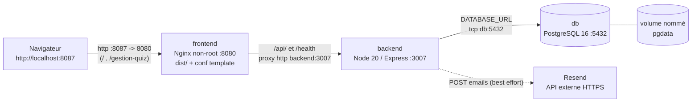

# Architecture locale — Quiz App (J1)

Document d'analyse préalable à la conteneurisation (docs/08 §8). Il décrit l'existant et les décisions de la pile Docker Compose locale ; les Dockerfiles et le `docker-compose.yml` en découlent.

## 1. Composants, rôles et dépendances

| Composant | Technologie | Rôle | Port (conteneur) | Dépend de |
| --- | --- | --- | --- | --- |
| Navigateur | — | Utilisateur du quiz (`/`) et de l'admin (`/gestion-quiz`) | — | frontend |
| Frontend | build Vite + Nginx (multi-étapes) | sert les pages statiques (`dist/`), reverse proxy de l'API | 8080 (nginx non-root) | backend |
| Backend | Node.js 20 / Express (`backend/server.js`) | API REST, authentification JWT admin, envoi d'email | 3007 | PostgreSQL, Resend |
| PostgreSQL | postgres:16-alpine | `users`, `quiz_results`, `answers` | 5432 | volume `pgdata` |
| Resend | API externe (HTTPS) | email de résultats (best effort) | — | — |

Dépendances constatées dans le code :

- Le frontend appelle l'API en chemin relatif `/api` (`main.js:3`), donc il **exige** un reverse proxy : il ne peut pas appeler le backend en direct.
- Le backend ne sert pas de fichiers statiques : Nginx doit servir `dist/` et proxifier `/api/` et `/health`.
- Le backend lit PostgreSQL via `pg.Pool` (`backend/server.js:48-53`) — 3 tables définies dans `database/init.sql`.
- **Point dur vérifié** : `new Resend(process.env.RESEND_API_KEY)` (`backend/server.js:55`) **lève une exception au démarrage si la variable est absente** (`Error: Missing API key`). Le conteneur backend ne démarre donc pas sans `RESEND_API_KEY`, même si l'envoi d'email n'est pas utilisé. Conséquence : une clé factice est obligatoire dans `.env` ; l'échec d'envoi réel est ensuite absorbé par le `try/catch` de `sendResultEmail` (`backend/server.js:415-433`) et n'empêche pas l'enregistrement du résultat.
- `GET /health` (`backend/server.js:437-439`) répond `{"status":"ok"}` **sans requête SQL** : il ne prouve pas que la base est joignable.

## 2. Schéma d'architecture locale

Seul le frontend publie un port sur l'hôte. `db` et `backend` restent sur le réseau interne du projet Compose et ne sont joignables que par leur nom de service.

## 3. Ports

| Port | Usage | Exposé sur l'hôte ? | Décision |
| --- | --- | --- | --- |
| 5173 | Vite en développement (`npm run dev`) | non en production | remplacé par le build statique |
| 3007 | backend Express | **non** | joignable seulement via Nginx |
| 5432 | PostgreSQL | **non** | joignable seulement par le backend |
| 8080 | Nginx du conteneur frontend (non-root) | non | port interne, non privilégié |
| 8087 | port hôte publié par Compose | oui | conserve les URL documentées (`http://localhost:8087`, `/gestion-quiz`) |

`8087` est choisi pour rester compatible avec les URL de `docs/08` et les habitudes de démonstration. `8080` côté conteneur est imposé par `nginxinc/nginx-unprivileged`, qui tourne en utilisateur non-root et ne peut pas écouter sur 80.

## 4. Variables de configuration

Publiques (non sensibles, peuvent figurer dans Compose) :

| Variable | Usage |
| --- | --- |
| `PORT` | port d'écoute du backend (3007) |
| `POSTGRES_DB` | nom de la base |
| `POSTGRES_USER` | utilisateur PostgreSQL |
| `FROM_EMAIL` | expéditeur affiché par Resend |
| `BACKEND_HOST` / `BACKEND_PORT` | cible de l'upstream Nginx, injectée au démarrage du conteneur frontend |

Secrets (uniquement dans `.env`, jamais commité, `.env.example` avec valeurs fictives) :

| Variable | Usage |
| --- | --- |
| `POSTGRES_PASSWORD` | mot de passe PostgreSQL |
| `DATABASE_URL` | chaîne de connexion complète (contient le mot de passe) |
| `RESEND_API_KEY` | clé d'API Resend (factice en local, obligatoire au démarrage) |
| `ADMIN_USERNAME` / `ADMIN_PASSWORD` | identifiants de l'espace d'administration |
| `JWT_SECRET` | signature des jetons admin |

Les scripts de build ne reçoivent **aucun** secret : le frontend est un build statique, et ses seules valeurs injectées (`BACKEND_HOST`, `BACKEND_PORT`) sont publiques.

## 5. Routes utilisables pour les tests

| Route | Attendu |
| --- | --- |
| `GET /` | 200, page du quiz |
| `GET /gestion-quiz` | 200, page d'administration |
| `GET /health` | 200, `{"status":"ok"}` (proxy vers le backend) |
| `POST /api/users` | 201, `{id, firstname, email}` |
| `POST /api/results` | 201, `{message, quizResultId}` |
| `POST /api/admin/login` | 200, `{token}` (Rate limiting : 100 req/15 min global, 5 inscriptions, 10 résultats) |

## 6. Questionnaires et persistance des résultats

- Les questionnaires sont des modules ES de la racine (`questions_docker.js`, `questions_ansible.js`, etc.) chargés dynamiquement par `import.meta.glob("./questions_*.js")` (`main.js:11-23`), donc figés dans le bundle au build : modifier un questionnaire exige un rebuild de l'image frontend.
- Les résultats sont écrits par `POST /api/results` dans PostgreSQL : 1 ligne `quiz_results` + 1 ligne `answers` par question, dans une transaction (`backend/server.js:307-333`).
- La base est initialisée par `database/init.sql`, monté dans `/docker-entrypoint-initdb.d/` : le script n'est joué **qu'au premier démarrage sur un volume vide**. Il ne contient pas `IF NOT EXISTS` et n'est pas rejouable ; toute évolution du schéma doit passer par un script de migration explicite, pas par un simple redémarrage.

## 7. Doublon `nginx/nginx.conf` / `database/nginx/nginx.conf`

Les deux fichiers sont **identiques octet pour octet** (`diff` vide). `nginx/nginx.conf` est la configuration historique du reverse proxy ; la copie sous `database/` provient de l'arborescence de la solution d'origine (un `nginx.conf` rangé à côté de `init.sql`) et n'est référencée par aucun chemin de build.

Décision : `nginx/nginx.conf` est la source de vérité, transformée en template pour le conteneur frontend (placeholder `*.template` + `envsubst`). `database/nginx/nginx.conf` n'est pas utilisé ; il est conservé tel quel en J1 (pas de suppression hors du périmètre) et signalé pour un nettoyage ultérieur.

## 8. Justification des images et du volume

| Image | Justification |
| --- | --- |
| `node:20-alpine` | `docs/08` impose Node ≥ 20 ; Alpine donne une image compacte et un shell (`sh`, `apk`) pour le diagnostic. Tag de version majeure, jamais `latest`. |
| `nginxinc/nginx-unprivileged:alpine` | même Nginx avec un utilisateur non-root : le conteneur ne peut pas modifier ses binaires, et écoute sur 8080. Le shell reste disponible pour `docker exec`. |
| `postgres:16-alpine` | version majeure supportée, image officielle, healthcheck `pg_isready` disponible. |
| Volume nommé `pgdata` | les données survivent à `docker compose down` et à la recréation du conteneur ; elles ne sont supprimées que par `docker compose down -v`. Un bind mount dépendrait du chemin de l'hôte et des droits du propriétaire. |

**Alpine plutôt que distroless/Chainguard** — décision explicite (J1 §2) : on conserve un shell et `apk`/`docker exec -it <conteneur> sh` pour diagnostiquer un incident en démonstration. C'est un compromis assumé : surface d'attaque un peu plus large (shell, gestionnaire de paquets) contre capacité de diagnostic direct. L'alternative durcie (distroless, Chainguard) est connue et sera réévaluée en J2 lors du durcissement/scan Trivy, pas ignorée par méconnaissance.

## 9. Conséquences pour la pile Compose

- Trois services : `db`, `backend`, `frontend` ; un seul port publié (`8087:8080`).
- `backend` attend `db` en état `service_healthy` (`pg_isready`), sinon la première requête SQL échoue en `ECONNREFUSED` alors que `/health` répond déjà 200.
- `backend` reçoit `RESEND_API_KEY` factice en local, sinon il refuse de démarrer.
- `frontend` attend `backend` démarré ; la résolution DNS de l'upstream Nginx est à vérifier au démarrage (hypothèse suivie en J1/J4).
- `.env` fournit les secrets ; `.env.example` documente les clés avec des valeurs fictives.
