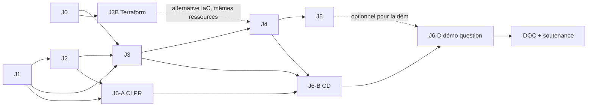

# Plan de réalisation — Quiz App (conteneurisation, sécurité, Azure, CI/CD)

Tableau de bord partagé humain/IA. Une étape = un fichier `plan/*.md` = une ou plusieurs branches `feature/*` = une ou plusieurs PR vers `main` du fork (`adam-benyekkou/eval-quiz-app`), jamais vers `franklin-tutorials/eval-quiz-app`.

Sources : docs/02, 03, 04, 06, 08, 09.

## Règles de collaboration humain / IA

1. Une branche par feature depuis `main` à jour (`git switch main && git pull && git switch -c feature/<nom>`), nom exact dans chaque étape.
2. Une PR par branche, base = `main` du fork ; pas de push direct sur `main`, pas de force-push.
3. Prendre une tâche : écrire son nom (ou `IA:<outil>`) dans le champ Assigné, cocher au fur et à mesure, commiter la mise à jour du plan avec le code.
4. Une case n'est cochée que si la commande de preuve a été exécutée ; coller la sortie expurgée dans `preuves/Jx/`. Pas de sortie, pas de coche.
5. Les cases « Je sais expliquer » sont cochées par l'humain uniquement après réexplication sans aide (docs/09).
6. Secrets : jamais envoyés à une IA ni commités (mots de passe, tokens, clé Resend, chaîne PostgreSQL réelle, secrets GitHub, sorties `az` avec identifiants). Preuves expurgées avant commit.
7. Commits conventionnels (`feat:`, `ci:`, `docs:`, `chore:`). Le hook `.githooks/prepare-commit-msg` ajoute les trailers `Co-authored-by` ; vérifier `git config core.hooksPath` = `.githooks` sur chaque clone.
8. Ne pas modifier la logique métier (`main.js`, `backend/server.js`, `questions_*.js`) sauf la question de J6-D.
9. Tout ce qu'une IA a rédigé est relu ligne par ligne par l'humain avant exécution, puis listé dans « Usage de l'IA » du README (étape DOC).

## Ordre et dépendances

Règles de séquencement :

- docs/03 impose que J1 soit validé avant tout déploiement cloud.
- J0 se fait en parallèle de J1, car il peut bloquer J3.
- J3B (Terraform) est un complément facultatif, pas un remplacement : `docs/02` exige `scripts/deploy.sh`/`destroy.sh` en Azure CLI, qui restent le livrable de référence. Ne pas faire gérer les mêmes ressources par les scripts et par Terraform en même temps (double coût, dérive d'état).

## Tableau d'avancement

| Étape | Fichier | Branches | Dépend de | Statut |
|---|---|---|---|---|
| Socle CI déjà fusionné | — | feature/co-author-commit, feature/trivy-scan, feature/hadolint | — | Fait (PR #1 à #3) |
| Plan | ce dossier | feature/plan | — | En cours |
| J0 | [J0-verification-azure.md](J0-verification-azure.md) | feature/j0-azure-check | — | À faire |
| J1 | [J1-conteneurisation-locale.md](J1-conteneurisation-locale.md) | feature/j1-analyse, feature/j1-backend-image, feature/j1-frontend-image, feature/j1-compose | — | À faire |
| J2 | [J2-securite-images.md](J2-securite-images.md) | feature/j2-trivy-baseline, feature/j2-hardening | J1 | À faire |
| J3 | [J3-azure-acr.md](J3-azure-acr.md) | feature/j3-azure-scripts | J0, J1, J2 | À faire |
| J3B (complément IaC) | [J3B-terraform-iac.md](J3B-terraform-iac.md) | feature/terraform-iac | J0 (recouvre J3/J4) | À faire |
| J4 | [J4-container-apps.md](J4-container-apps.md) | feature/j4-container-apps | J3 | À faire |
| J5 | [J5-postgresql-cloud.md](J5-postgresql-cloud.md) | feature/j5-neon | J4 | À faire |
| J6 | [J6-cicd.md](J6-cicd.md) | feature/j6-ci-images, feature/j6-branch-protection, feature/j6-cd-azure, feature/j6-demo-question | J1, J2 puis J3, J4 | À faire |
| DOC | [DOC-soutenance.md](DOC-soutenance.md) | feature/docs | au fil de l'eau | À faire |

## État initial (faits vérifiés)

- Présents : `.github/workflows/trivy.yml` (scan filesystem vuln, secret, misconfig, bloquant CRITICAL et HIGH, sur PR vers `main`), `hadolint.yml` (lint de tout Dockerfile*), hook co-auteurs.
- Absents : Dockerfiles, `docker-compose.yml`, `scripts/`, `preuves/`, workflow de build d'images, workflow de déploiement.
- Backend : Express port 3007 ; `GET /health` renvoie `{"status":"ok"}` sans requête SQL ; `pg.Pool` créé sans option `ssl` ; variables lues : `DATABASE_URL`, `RESEND_API_KEY`, `FROM_EMAIL`, `ADMIN_USERNAME`, `ADMIN_PASSWORD`, `JWT_SECRET`, `PORT`.
- Frontend : Vite multi-page (`index.html`, `gestion-quiz.html`) ; appelle l'API en chemin relatif `/api`, donc dépend d'un reverse proxy.
- `nginx/nginx.conf` : écoute 80, upstream backend vers `backend:3007`, proxy `/api/` et `/health` ; copie dans `database/nginx/nginx.conf` (rôle à comprendre en J1).
- `database/init.sql` : 3 tables (`users`, `quiz_results`, `answers`) sans `IF NOT EXISTS`, donc non rejouable.
- Écart avec la demande : le dossier s'appelle `~/Cours/eval-quiz-app` (pas `quiz-eval`).

## Points à vérifier expérimentalement

Ce sont des inférences, pas des faits.

| Hypothèse | Étape |
|---|---|
| `new Resend(undefined)` ne plante pas sans RESEND_API_KEY | J1 puis J4 |
| `?sslmode=require` dans DATABASE_URL suffit pour Neon avec pg 8 sans modifier le code | J5 |
| Le nom d'app Container Apps `backend` résout en interne mais pas sur le port 3007 ; `nginx.conf` devra être paramétré | J4 |
| nginx démarre-t-il si backend injoignable (résolution de l'upstream au démarrage) ? | J1, J4 |
| Création de service principal/OIDC permise sur Azure for Students | J0 |
| Les noms de checks requis sont ceux publiés par la première exécution CI | J6 |

## Définition de « fait »

- Toutes les cases cochées, avec sorties dans `preuves/Jx/`.
- PR fusionnée sur `main` du fork après CI verte.
- Démo de moins de 3 minutes par l'humain, sans IA.
- Statut mis à jour dans le tableau d'avancement.
